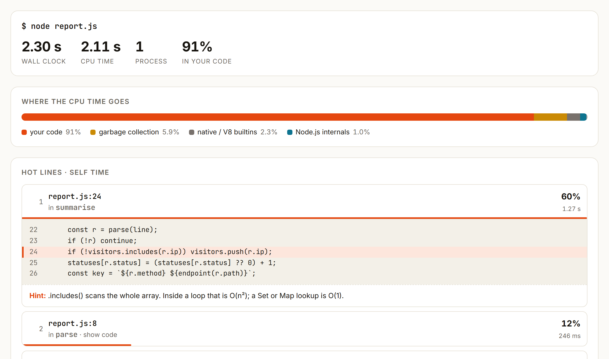
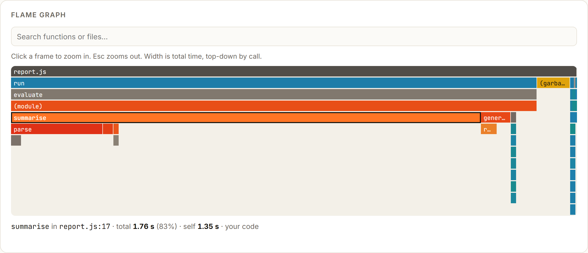

<div align="center">

# perfproof

**Find the slow line. Prove the fix.**

A CPU profiler for Node.js that answers with the exact lines burning your CPU, plus a benchmark that
tells you whether your change really made it faster. Works on whole command trees like `npm test`,
and is built to be used by you or by your coding agent.

[**Live demo**](https://feresbr1.github.io/perfproof/#/demo) ·
[Open a .cpuprofile](https://feresbr1.github.io/perfproof/#/view) ·
[Releases](https://github.com/feresbr1/perfproof/releases) ·
[Issues](https://github.com/feresbr1/perfproof/issues)

</div>

```console
$ npx github:feresbr1/perfproof run -q -- node report.js
perfproof: profiling node report.js
perfproof · node report.js
wall 2.18 s · CPU 2.00 s · 1 process

Where the CPU time goes
  your code                         90%  ██████████████████··  1.80 s
  garbage collection               6.3%  █···················  127 ms
  native / V8 builtins             1.7%  ····················  34.2 ms
  Node.js internals                1.7%  ····················  33.7 ms

Hot lines (self time)
   1. report.js:24  summarise  1.24 s  62%
        22 |     const r = parse(line);
        23 |     if (!r) continue;
      > 24 |     if (!visitors.includes(r.ip)) visitors.push(r.ip);
        25 |     statuses[r.status] = (statuses[r.status] ?? 0) + 1;
        26 |     const key = `${r.method} ${endpoint(r.path)}`;
      hint: .includes() scans the whole array. Inside a loop that is O(n²); a Set or Map lookup is O(1).
   2. report.js:8  parse  220 ms  11%
         6 |
         7 | function parse(line) {
      >  8 |   const m = new RegExp(LINE).exec(line);
         9 |   if (!m) return null;
        10 |   return { ip: m[1], method: m[3], path: m[4], status: Number(m[5]), ms: Number(m[7]) };
      hint: A RegExp is compiled on a hot line; build it once outside the loop.
...
```

Save a baseline, fix those two lines (a `Set`, and the regex built once: that is
[`report.fast.js`](examples/log-report/report.fast.js)), and compare:

```console
$ perfproof bench --save before -- node report.js
perfproof bench · node report.js
  10 runs: 2.02 s ± 101 ms (95% CI) · median 2.07 s · min 1.82 s · max 2.24 s · sd 141 ms
perfproof: saved baseline "before" (.perfproof\baselines\before.json)

$ perfproof bench --compare before -- node report.fast.js
perfproof bench · node report.fast.js
  10 runs: 703 ms ± 41.5 ms (95% CI) · median 691 ms · min 633 ms · max 807 ms · sd 58.1 ms
  baseline "before": 2.02 s ± 101 ms (10 runs)

  FASTER: 2.88× faster than the baseline (-65.2% time, p < 0.0001)
```

Real output from [`examples/log-report`](examples/log-report) on a Windows laptop (a few progress
lines on stderr trimmed). Timings will differ on your machine.

## Why

- **Profiles are hard to act on.** `node --cpu-prof` gives you a JSON call tree that you then
  explore by hand in DevTools. perfproof reads it for you and ranks the **lines** that cost the most,
  with the code around them.
- **Real workloads are many processes.** `npm test` is npm + a test runner + workers. perfproof
  profiles every Node.js process a command starts and merges them. (This relies on `--cpu-prof` in
  `NODE_OPTIONS`, which Node.js only allows since 22.15 / 23.9:
  [nodejs/node#56944](https://github.com/nodejs/node/issues/56944).)
- **The obvious profile can point at the wrong line.** When V8 optimises a hot loop with on-stack
  replacement, its samples are blamed on the line that _called_ the function. perfproof turns that
  off while profiling so the hot line is the one you need to change.
- **"Feels faster" is not evidence.** `perfproof bench` saves a baseline, re-runs after your change
  and applies Welch's t-test, so noise is reported as noise.
- **Agents guess at performance.** The text report is short, ranked and plain, so a coding agent can
  read it, fix the top line and back its claim with a verdict. A ready-made [skill](skills/perfproof/SKILL.md)
  teaches it the loop.

## Features

- `perfproof run -- <command>`: profiles the command and all its Node.js child processes and worker
  threads.
  - Hot lines with source and enclosing function, plus hints for common slow patterns: linear scans
    in loops, regexes rebuilt per call, sync I/O, quadratic spreads, `shift()` queues and more.
  - Hot functions with self and total time.
  - Time split between your code, dependencies, Node.js internals, native code and GC.
  - Notes that flag heavy GC, dependency-dominated profiles, parents waiting on children, and
    I/O-bound runs where a CPU profile can't help.
  - Every run is saved to `.perfproof/runs/<time>/` as `report.md`, `report.json`, the raw
    `.cpuprofile` files and **`flamegraph.html`**: one self-contained file with the report and a
    zoomable, searchable flame graph.
- `perfproof bench -- <command>`: warm-up plus N timed runs, mean ± 95% CI, median, min/max.
  - `--save before` / `--compare before` for baselines, Welch's t-test, and a verdict line.
  - `--fail-if-slower` to gate scripts.
- `perfproof analyze <file|dir>`: the same report for existing `.cpuprofile` files, from Node.js or
  Chrome DevTools.
- Output as text (default), `--md` (for PRs) or `--json`.
- **Web viewer** at [feresbr1.github.io/perfproof](https://feresbr1.github.io/perfproof/#/view):
  drop `.cpuprofile` files or a perfproof `report.json`. Everything runs in your browser; nothing is
  uploaded.
- One dependency-free file. No install, no account, no native addons, no telemetry.

<p align="center">
  
</p>
<p align="center">
  
</p>

## Quick start

Requires **Node.js 22.15 or newer**.

```sh
# Profile anything that runs on Node.js
npx github:feresbr1/perfproof run -- node scripts/build.js
npx github:feresbr1/perfproof run -q -- npm test

# Benchmark before and after a change
npx github:feresbr1/perfproof bench --save before -- node scripts/build.js
# ...edit the code...
npx github:feresbr1/perfproof bench --compare before -- node scripts/build.js
```

Prefer a shorter command? Install it globally or as a dev dependency:

```sh
npm install -g github:feresbr1/perfproof      # then: perfproof run -- ...
npm install -D github:feresbr1/perfproof      # then: npx perfproof run -- ...
```

Or download `perfproof.mjs` from the [latest release](https://github.com/feresbr1/perfproof/releases/latest)
and run `node perfproof.mjs run -- ...`.

## Use it with a coding agent

Install the skill (Claude Code, Codex, Cursor, Gemini CLI and other agents that read `SKILL.md`):

```sh
npx skills add feresbr1/perfproof
```

Then ask "make the build faster" or "why is this test slow?". The skill tells the agent to save a
baseline, profile, fix the hottest code it owns, re-benchmark, and report the verdict line instead
of an impression. Without the skill, run `npx github:feresbr1/perfproof guide` and paste the
workflow into your agent's instructions.

## Usage

```text
perfproof run [options] -- <command...>      Profile a command and every Node.js process it starts
perfproof bench [options] -- <command...>    Time a command, save a baseline, compare against it
perfproof analyze <file|dir>... [options]    Report on existing .cpuprofile files
perfproof guide                              The workflow, written for coding agents
```

| Option               | Commands     | Meaning                                                   |
| -------------------- | ------------ | --------------------------------------------------------- |
| `--top <n>`          | run, analyze | Hot lines and functions to show (default 8)               |
| `--json`, `--md`     | all          | Machine-readable or Markdown output                       |
| `-q`, `--quiet`      | run          | Hide the command's own output                             |
| `--interval <µs>`    | run          | Sampling interval (default 500 µs)                        |
| `--no-precise`       | run          | Keep V8's on-stack replacement (faster, less exact lines) |
| `--no-save`          | run          | Don't keep the run in `.perfproof/runs/`                  |
| `--open`             | run, analyze | Open the flame graph in a browser                         |
| `--html <file>`      | analyze      | Write the flame graph HTML                                |
| `-n`, `--runs <n>`   | bench        | Timed runs (default 10)                                   |
| `-w`, `--warmup <n>` | bench        | Untimed warm-up runs (default 1)                          |
| `--save [name]`      | bench        | Save timings as a baseline (default name `baseline`)      |
| `--compare [name]`   | bench        | Compare with a saved baseline                             |
| `--fail-if-slower`   | bench        | Exit 1 when significantly slower than the baseline        |
| `--show-output`      | bench        | Show the command's output                                 |

`run` exits with the command's own exit code, so it can wrap test suites in scripts. Baselines live
in `.perfproof/baselines/<name>.json`; pass a path ending in `.json` to keep one elsewhere (for
example, committed to the repo).

### How the verdict works

`bench` runs the command `warmup + n` times and keeps the `n` timed runs. `--compare` applies
Welch's t-test (which does not assume equal variances) to the two sets of timings. The verdict is
**FASTER** or **SLOWER** only when p < 0.05 _and_ the means differ by at least 2%; otherwise it is
**NO SIGNIFICANT DIFFERENCE**. If runs vary by more than 10%, perfproof says so; add runs with `-n`.

## How it works

1. `run` sets `NODE_OPTIONS=--cpu-prof --cpu-prof-dir=<run dir> --require=<preload>`, so every
   Node.js process in the tree writes a V8 CPU profile when it exits.
2. The preload switches off on-stack replacement (accurate lines) and turns an unhandled
   SIGTERM/SIGINT into a normal exit, so workers stopped by a test runner still write their profile.
3. perfproof parses the profiles, weights each sample by its real duration, splits time across
   lines using V8's position ticks, and computes self and total time per function (recursion counted
   once). Function names for hot lines come from the source, so inlined code is named correctly.
4. Hot lines in your files get a snippet and a pattern hint; everything is written as text,
   Markdown, JSON and a self-contained HTML flame graph.

## Supported platforms and limitations

- **Node.js 22.15+** on Linux, macOS and Windows. Bun and Deno are not supported.
- Line numbers refer to the JavaScript Node.js ran. TypeScript run with Node's built-in type
  stripping (`node app.ts`) maps to the right lines; bundled or transpiled output is reported as
  generated code (no source maps yet).
- A process writes its profile only if it exits normally or by an unhandled SIGTERM/SIGINT. On
  **Windows**, workers that a test runner kills are terminated without a signal and are not captured:
  for Vitest use `--pool=threads`, or profile a single test file.
- Precise mode disables on-stack replacement, which can slow long-running loops while profiling. Use
  `bench` (no profiler attached) for timing claims.
- It is a CPU profiler: time spent waiting on network, disk or timers is not explained (perfproof
  notes when a run is mostly idle).
- Hints are heuristics on the hot line's text, not diagnoses.

## Development

```sh
npm install
npm run check        # format, lint, typecheck, unit + CLI tests, build
npm run test:e2e     # Playwright tests of the web viewer (desktop and mobile)
npm run dev          # the website
npm run build:cli && npm run demo-data   # refresh the demo from examples/log-report
```

Tech: TypeScript, Preact + Vite (viewer and site), esbuild (single-file CLI), Vitest, Playwright.
The CLI has no runtime dependencies.

See [CONTRIBUTING.md](CONTRIBUTING.md). Product reasoning and alternatives considered are in
[docs/PRODUCT_DECISIONS.md](docs/PRODUCT_DECISIONS.md).

## License

[MIT](LICENSE)
